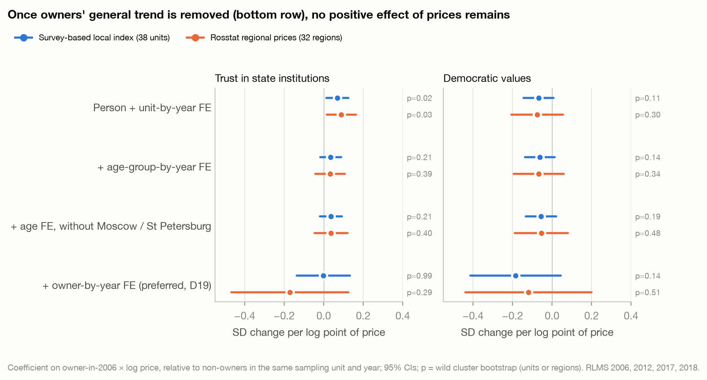

# Did owning a piece of privatized Russia change people's politics?

**Status: parked (November 2026).** An exploratory research project using the Russia Longitudinal
Monitoring Survey (RLMS-HSE). The data and the question are interesting; the designs tried here do
not identify a clear effect. Everything below reruns from the raw files with one command.



**What the figure estimates.** For adult *i* in RLMS sampling unit *u*, region *r* and survey round
*t* ∈ {2006, 2012, 2017, 2018}:

$$
y_{it} = \beta\,\big(\text{Own}_{i,2006} \times \log P_{r,t}\big) + \alpha_i + \gamma_{u,t} + [\,\delta_{a,t}\,] + [\,\theta_{\text{Own},t}\,] + \varepsilon_{it}
$$

- *y*: trust-in-state-institutions index (government, Duma, courts, army, police, parties) or
  democratic-values index (importance of free elections, free speech, a free press, an opposition),
  each in standard deviations of 2006.
- *Own*<sub>i,2006</sub>: the household owned its home in 2006, fixed at baseline.
- *P*: average price per m² on the secondary housing market, end of year. Blue = leave-one-out
  index of RLMS owners' own valuations in the sampling unit (38 units); orange = Rosstat regional
  price (32 regions).
- *β*: change in owners' attitude, relative to non-owners in the same unit and year, per log point
  of price (one log point ≈ prices × 2.7).

| Row in figure | Fixed effects | Identifying variation | Trust index (Rosstat prices) | Democratic values (Rosstat prices) |
|---|---|---|---|---|
| Person + unit-by-year FE | α<sub>i</sub>, γ<sub>u,t</sub> | national price path + regional differences | +0.090 (wild p 0.03) | −0.075 (p 0.30) |
| + age-group-by-year FE | + δ<sub>a,t</sub> (18–30, 31–45, 46–60, 61+) | same, net of age-specific trends | +0.033 (p 0.39) | −0.067 (p 0.34) |
| + age FE, without Moscow / St Petersburg | as above, two capitals dropped | same | +0.037 (p 0.40) | −0.054 (p 0.48) |
| + owner-by-year FE | + θ<sub>Own,t</sub> | **regional differences only** | −0.171 (p 0.29) | −0.120 (p 0.51) |

Standard errors are clustered by region for Rosstat prices (by sampling unit for the survey
index); p-values are wild cluster bootstrap. The panel has 6,985 adults observed in at least
two of the four rounds, 77% of them owners in 2006.

**Why the sign changes in the last row.** Prices rose almost everywhere at once (by about 0.54 log
points between 2006 and 2012). In the first three rows, owners' price exposure therefore moves mostly
with the calendar, and β also absorbs anything else that moved owners relative to non-owners over
those years. The owner-by-year effects θ remove every owner-specific change common to all regions,
so β is identified only by whether owners in regions with *faster-than-average* price growth
changed more than owners elsewhere. Those regional differences are small (SD about 0.19), so the
estimate is noisy. The two readings are discussed below.

## The question

Mass privatization made most Russians owners overnight: of their flats (free privatization from
1991), and briefly of shares in their employers. Does acquiring a stake make people more *loyal* to
the state ("more to lose") or more *demanding* of it (protection of property, rights, elections)?

## What was tried

1. **1990s histories and 2006 attitudes** (`01_analyze_longrun_2006.py`). In 2006 RLMS asked what
   should be done with enterprises privatized earlier. Two-thirds of those with a view favour
   revising privatization (66% overall, 69-74% in every comparison group), and none of the 1990s histories (early workplace share ownership,
   losing those shares, the household's flat privatization path, running a 1980s cooperative)
   predicts the answer. Four attitude indices (market legitimacy, democratic values, trust in
   state institutions, approval of the state) show nothing that survives multiple-testing correction.
2. **Housing wealth** (`03_analyze_housing_wealth.py`, figure above). Owners in 2006 vs non-owners in
   the same sampling unit and year, as regional house prices change (Rosstat secondary-market
   prices per m2, 32 regions; RLMS rounds 2006, 2012, 2017, 2018 that ask about trust and democratic
   values). Person, unit-by-year and age-group-by-year fixed effects; wild cluster bootstrap by region.
3. **Event study around the 2008-09 price bust** (`05_analyze_event_study.py`), using the only
   attitude items asked every year (life and economic satisfaction): no break for owners in
   regions where prices fell more.
4. **Robustness**: flexible baseline-by-year controls with LASSO post-double-selection (R2),
   permutation of regional price paths (R3), second-flat owners, and sign diagnostics (R4).

## The open puzzle: how to read the housing estimates

The figure's top three rows say that as prices rose, owners came to trust state institutions a
little more than non-owners (+0.09 SD per log point without age controls, about +0.03 with them).
The bottom row adds **owner-by-year fixed effects**, and the estimate turns negative and insignificant
(trust index -0.17, wild bootstrap p 0.29; permutation p 0.34).

The two rows use different variation, and neither reading is settled:

- Without owner-by-year effects, the estimate leans on the **national** price path: prices rose about
  0.54 log points from 2006 to 2012 everywhere, and owners' trust rose relative to non-owners in
  2012 (+0.055 SD, p 0.07) even without any price term (`11_robust_sign_diagnostics.py`). That could be
  a genuine nationwide housing-wealth effect, or any other trend that moved owners (older, more
  settled) differently in those years. With one national price path the two cannot be separated.
- With owner-by-year effects, only **cross-regional** differences in price changes identify the
  effect. They are much smaller (SD about 0.19 across regions), so the estimate is imprecise. It is
  negative in all 32 leave-one-region-out runs but never significant.

A design that could settle this needs price variation that is unrelated to other owner trends, for
example a supply-side instrument (regions where construction could not keep up with national
demand). That is the most promising next step if the project is picked up again.

## Reproduce

The RLMS-HSE files are **not included**: they are free but require a personal account and a data use
agreement at <https://www.hse.ru/en/rlms/>. Download the household and individual longitudinal Stata
files (1994-2025, English) into `data/raw/rlms/` as described in
`data/scripts/collection/acquire_rlms.py`. Regional house prices are downloaded and parsed by
`acquire_housing_prices.py` and `clean_housing_prices.py` (not redistributed here); the 2021 values
are checked against Rosstat's own file for all 84 regions.

```bash
uv sync                                     # Python environment from uv.lock
uv run python run_all.py --with-collection  # download prices, then clean -> process -> analyze
uv run python run_all.py                    # later runs: rebuild from data/raw/ offline
```

A full run takes about four minutes (most of it the wild bootstrap and permutation draws). The
16 GB individual file is streamed out of its `.7z` archive and never unpacked to disk. Two
consecutive runs produce byte-identical results files.

## Layout

```
data/raw/            raw files (RLMS not included) + provenance READMEs + MANIFEST.sha256
data/scripts/        collection -> cleaning -> processing (one script per stage and dataset)
empirics/scripts/    numbered analyses and figures
empirics/results/    coefficient tables (CSV), figures, warnings, logs
screening/           pre-pipeline feasibility checks of which RLMS rounds ask which questions
ANALYSIS_PLAN.md     every analytical decision (D1-D19) and robustness check (R1-R4), with a change log
research-state.md    current state and session history
```

## Data sources

- Russia Longitudinal Monitoring Survey, RLMS-HSE, conducted by HSE University and the Carolina
  Population Center, UNC (<https://www.hse.ru/en/rlms/>).
- Rosstat average prices on the secondary housing market (form 1-RZh), regional, end of year,
  2001-2025, as republished on statbase.ru; Rosstat's 2021 regional file via the Internet Archive.
